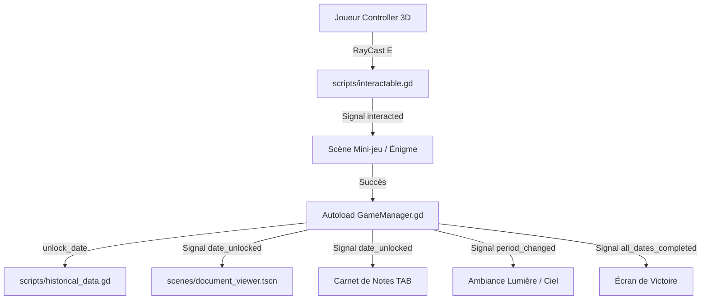

# 🗺️ Feuille de Route de Développement Complète — "Les Archives" (WW2)
**Destinée à :** Thomas & Raphaël (Développeurs Godot)  
**Game Design :** Ilyem | **Modélisation 3D :** Louka  
**Moteur :** Godot 4.7.2 (Mode GL Compatibility / 3D First Person)

---

## 📌 Sommaire
1. [Vue d'ensemble de l'Architecture](#1-vue-densemble-de-larchitecture)
2. [Systèmes Communs & Outils Pratiques](#2-systèmes-communs--outils-pratiques)
3. [Répartition des Tâches : Thomas vs Raphaël](#3-répartition-des-tâches--thomas-vs-raphaël)
4. [Détail des 15 Énigmes à Coder (Phase par Phase)](#4-détail-des-15-énigmes-à-coder)
5. [Interface : Le Carnet d'Archives (Touche TAB)](#5-interface--le-carnet-darchives-touche-tab)
6. [Système d'Ambiance Temporelle (Nuit ➔ Aube ➔ Jour)](#6-système-dambiance-temporelle)
7. [Workflow d'Intégration des Modèles 3D de Louka](#7-workflow-dintégration-des-modèles-3d-de-louka)
8. [Écran de Victoire & Épilogue Historique](#8-écran-de-victoire--épilogue-historique)
9. [Checklist Finale Avant la Démo](#9-checklist-finale-avant-la-démo)

---

## 1. Vue d'ensemble de l'Architecture

Le projet s'organise autour d'un principe simple : **séparer la logique des énigmes du visuel 3D** afin que vous puissiez tout coder immédiatement avec des cubes simples sans attendre Louka.

---

## 2. Systèmes Communs & Outils Pratiques

### 2.1 Enregistrer le `GameManager` en Autoload
Dans le menu de Godot : **Projet > Paramètres du projet > Autoload (Chargement automatique)**  
- Chemin : `res://scripts/game_manager.gd`
- Nom : `GameManager`  
*(Permet à n'importe quel script d'écrire `GameManager.unlock_date("pologne_1939")`)*.

### 2.2 Modèle universel pour les énigmes
Chaque énigme utilise le même schéma pour simplifier la vie des deux dévs :
1. **L'objet dans la pièce** est un `StaticBody3D` avec un script qui hérite de `Interactable`.
2. À l'appui sur `E`, l'objet instancie ou affiche son interface d'énigme (ex: zoom sur l'horloge, fenêtre popup de la machine à écrire).
3. Le joueur résout le mini-jeu.
4. Le mini-jeu appelle `GameManager.unlock_date(date_id)`.
5. Le document historique s'ouvre automatiquement.
6. L'objet 3D se verrouille en état "résolu" (ou s'anime).

---

## 3. Répartition des Tâches : Thomas vs Raphaël

Pour éviter les conflits Git et avancer en parallèle sans blocage :

| Développeur | Responsabilités Systèmes | Énigmes Attribuées |
| :--- | :--- | :--- |
| **Thomas (Dev 1)** | • Carnet d'Archives `[TAB]` • Gestionnaire d'ambiance Période 1/2/3 • Système d'inspection 2D/Cartes | **Dates 1, 3, 4, 7, 11, 13** (Dossier Pologne, Carte Sedan, Horloge 18h36, Loupe Midway, Tableau Normandie, Photo déchirée Elbe) |
| **Raphaël (Dev 2)** | • Enregistrement Autoload GameManager • Bannière Toast de découverte • Écran de Victoire final (15/15) | **Dates 2, 5, 6, 8, 9, 10, 12, 14, 15** (Radio BBC, Cadenas 1941, Machine à écrire TORA, Boussole El-Alamein, Veste Stalingrad, Chaise mobile Sicile, Tampon Bagration, Digicode Archives 1945, Coffre Manhattan 08h15) |

---

## 4. Détail des 15 Énigmes à Coder

### 🔵 PÉRIODE 1 : Les conquêtes de l'Axe (1939-1941)

#### Date 1 — 1er septembre 1939 : Invasion de la Pologne (Thomas)
- **ID :** `pologne_1939`
- **Placeholder 3D :** Pavé fin marron sur le bureau (`Dossier_Pologne`) + petit cylindre (`Coupe_Papier`).
- **Logique :** Ramasser le coupe-papier, ouvrir le dossier scellé ➔ fiche de cours débloquée.

#### Date 2 — 3 septembre 1939 : Déclaration de guerre FR / RU (Raphaël)
- **ID :** `declaration_guerre_1939`
- **Placeholder 3D :** Boîte rectangulaire en bois posée sur l'étagère de gauche (`Radio_Placeholder`).
- **Logique :** Clic sur la radio ➔ pop-up ou zoom avec un curseur de fréquence (100 à 500 kHz). La note indique la BBC à 390 kHz. Syntoniser sur 390 kHz déclenche l'annonce solennelle et valide la date.

#### Date 3 — 10 mai 1940 : Offensive allemande à l'Ouest (Thomas)
- **ID :** `offensive_ouest_1940`
- **Placeholder 3D :** Grand rectangle vert posé à plat sur le bureau (`Sous_Main_Bureau`).
- **Logique :** Soulever le sous-main ➔ carte d'état-major. Placer 3 pions tactiques sur Sedan/Ardennes, Belgique et Pays-Bas pour reconstituer le *Blitzkrieg*.

#### Date 4 — 22 juin 1940 : Armistice franco-allemand (Thomas)
- **ID :** `armistice_1940`
- **Placeholder 3D :** Cylindre plat au-dessus de la porte (`Horloge_Murale`).
- **Logique :** Brouillon dans la corbeille indiquant "signé à 18h36". Tourner les aiguilles de l'horloge sur 18h36 ➔ compartiment secret s'ouvre avec l'acte d'armistice.

#### Date 5 — 22 juin 1941 : Opération Barbarossa (Raphaël)
- **ID :** `barbarossa_1941`
- **Placeholder 3D :** Tiroir du classeur métallique vert (`Classeur_Tiroir`).
- **Logique :** Cadenas à 4 chiffres. Code `1941`. Ouvre le tiroir avec le dossier d'invasion de l'URSS. Déclenche le passage à la Période 2 (Aube).

---

### 🟠 PÉRIODE 2 : Le tournant de la guerre (1942-1943)

#### Date 6 — 7 décembre 1941 : Attaque de Pearl Harbor (Raphaël)
- **ID :** `pearl_harbor_1941`
- **Placeholder 3D :** Machine à écrire sur le meuble latéral (`Machine_Ecrire`).
- **Logique :** Saisie des lettres `T O R A` (*Tora! Tora! Tora!*). La machine tape le message d'alerte de l'attaque sur Hawaï.

#### Date 7 — Juin 1942 : Bataille de Midway (Thomas)
- **ID :** `midway_1942`
- **Placeholder 3D :** Loupe sur la table basse + photo de la flotte maritime au mur.
- **Logique :** Pointer la loupe sur les coordonnées océaniques pour repérer le porte-avions *Akagi* en flammes.

#### Date 8 — Novembre 1942 : Bataille d'El-Alamein (Raphaël)
- **ID :** `el_alamein_1942`
- **Placeholder 3D :** Boussole militaire en laiton sur le rebord de fenêtre (`Boussole_Laiton`).
- **Logique :** Aligner l'aiguille de la boussole sur le cap Sud-Est (135°) selon les ordres de Montgomery.

#### Date 9 — 2 février 1943 : Capitulation à Stalingrad (Raphaël)
- **ID :** `stalingrad_1943`
- **Placeholder 3D :** Manteau d'officier sur le portemanteau (`Veste_Militaire`).
- **Logique :** Fouiller la poche de la veste pour extraire la lettre du général Paulus et l'ordre de reddition.

#### Date 10 — Juillet 1943 : Débarquement allié en Sicile (Raphaël)
- **ID :** `sicile_1943`
- **Placeholder 3D :** Chaise de bureau à roulettes (`Chaise_Bureau`) + Boîte haute d'archives (`Boite_Haute`).
- **Logique :** Pousser la chaise devant l'étagère pour monter dessus et récupérer la boîte de l'Opération Husky. Déclenche le passage à la Période 3 (Plein jour).

---

### 🟡 PÉRIODE 3 : La victoire des Alliés (1944-1945)

#### Date 11 — 6 juin 1944 : Débarquement en Normandie (Thomas)
- **ID :** `debarquement_normandie_1944`
- **Placeholder 3D :** Tableau en liège au mur (`Tableau_Liege`).
- **Logique :** Relier les 5 étiquettes de plages (*Utah, Omaha, Gold, Juno, Sword*) aux bons secteurs avec des fils rouges pour dévoiler l'ordre d'Eisenhower.

#### Date 12 — 22 juin 1944 : Opération Bagration (Raphaël)
- **ID :** `operation_bagration_1944`
- **Placeholder 3D :** Tampon encreur sur le buvard (`Tampon_Encreur`).
- **Logique :** Tremper le tampon dans l'encre rouge et tamponner le document officiel de l'Armée rouge en Biélorussie.

#### Date 13 — 26 avril 1945 : Jonction des armées sur l'Elbe (Thomas)
- **ID :** `jonction_elbe_1945`
- **Placeholder 3D :** Cadre photo retourné (`Cadre_Photo_Elbe`).
- **Logique :** Réassembler les 2 morceaux déchirés de la photo montrant la poignée de main historique à Torgau.

#### Date 14 — 8 mai 1945 : Capitulation de l'Allemagne (Raphaël)
- **ID :** `capitulation_allemagne_1945`
- **Placeholder 3D :** Grande porte des archives + boîtier digicode (`Digicode_Porte`).
- **Logique :** Entrer le code `1945` pour déverrouiller la porte des archives et accéder au coffre-fort.

#### Date 15 — 6 et 9 août 1945 : Hiroshima et Nagasaki (Raphaël & Thomas)
- **ID :** `bombardements_atomiques_1945`
- **Placeholder 3D :** Gros coffre-fort métallique (`Coffre_Fort`).
- **Logique :** Entrer l'heure 08h15 sur le cadran pour ouvrir le dossier du Projet Manhattan. Déclenche l'écran de victoire finale.

---

## 5. Interface : Le Carnet d'Archives (Touche TAB)
*(Développé par Thomas)*

Un classeur accessible à tout moment en appuyant sur `TAB` :
- Affiche le compteur de progression global (ex: `7 / 15`).
- Présente les 3 périodes avec des onglets ou 3 colonnes.
- Les dates non encore trouvées sont masquées avec un cadenas `🔒 [Document classifié]`.
- Les dates trouvées sont cliquables pour relire le résumé de cours à tout moment.

---

## 6. Système d'Ambiance Temporelle
*(Développé par Thomas)*

Connecté au signal `GameManager.period_changed(new_period)` :
- **Période 1 :** Nuit, ciel sombre, lampe de bureau allumée.
- **Période 2 :** Aube orangée/bleutée, ciel plus clair.
- **Période 3 :** Plein jour ensoleillé, lumière franche entrant par la fenêtre.

---

## 7. Workflow d'Intégration des Modèles 3D de Louka

Pour remplacer un cube par le vrai modèle de Louka sans toucher au code :
1. Placer le modèle `.glb` de Louka dans `assets/models/`.
2. Ouvrir la scène ou le nœud de l'objet dans Godot.
3. Masquer ou supprimer le `MeshInstance3D` du cube temporaire.
4. Glisser le modèle 3D de Louka en enfant du `StaticBody3D`.
5. Ajuster la `CollisionShape3D` aux dimensions du modèle si nécessaire.

---

## 8. Écran de Victoire & Épilogue Historique
*(Développé par Raphaël)*

Déclenché par le signal `GameManager.all_dates_completed` :
- Résumé de la fin de la Seconde Guerre mondiale (capitulation du Japon le 2 septembre 1945, bilan humain, création de l'ONU).
- Affichage du carnet complet 15/15 validé.
- Bouton pour recommencer ou retourner au menu principal.

---

## 9. Checklist d'Avancement

- [x] `GameManager` configuré en Autoload.
- [x] Le carnet `[TAB]` opérationnel (gestion souris & pause).
- [x] Notification Toast lors de la découverte d'une archive.
- [x] **Date 1** (1er Septembre 1939 - Pologne) : Dossier sur le bureau.
- [x] **Date 2** (3 Septembre 1939 - Déclaration FR/RU) : Poste radio T.S.F. & syntonisation 390 kHz.
- [ ] **Date 3** (10 Mai 1940 - Offensive à l'Ouest) : Carte sous-main & 3 pions.
- [ ] **Date 4** (22 Juin 1940 - Armistice) : Horloge murale 18h36.
- [ ] **Date 5** (22 Juin 1941 - Barbarossa) : Cadenas 1941 sur le classeur vert.
- [ ] Transition visuelle Période 1 ➔ Période 2 (Aube).
- [ ] Période 2 (Dates 6 à 10).
- [ ] Transition visuelle Période 2 ➔ Période 3 (Jour).
- [ ] Période 3 (Dates 11 à 15).
- [ ] Écran de Victoire final (15/15).
- [ ] Intégration des modèles 3D de Louka (.glb).
